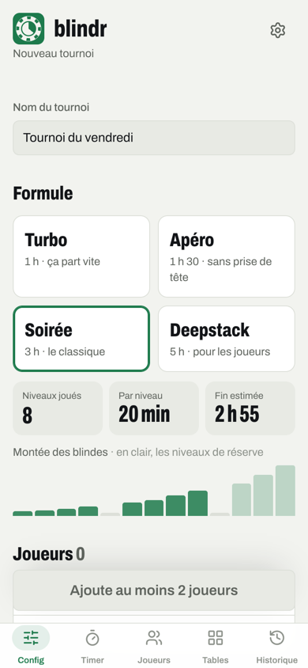
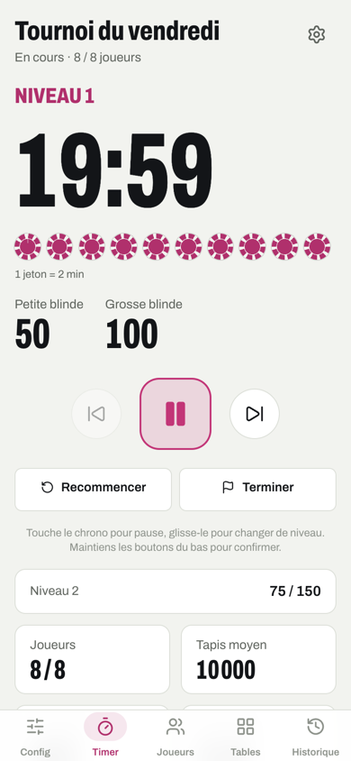
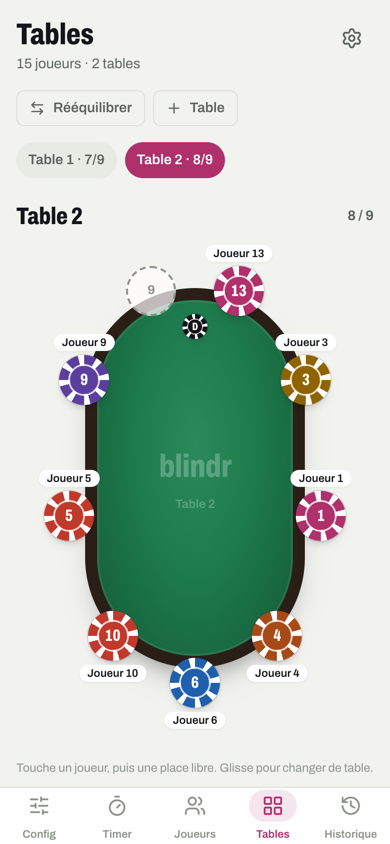
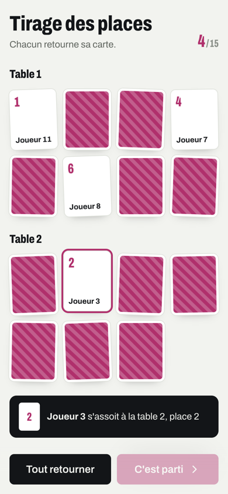
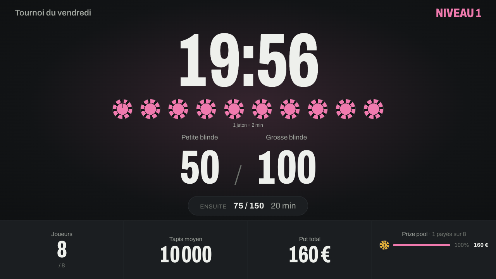

# Blindr

**Le timer de tournoi de poker pour les parties entre amis.** Blindes, joueurs, tables et prize pool, sur téléphone, tablette ou TV. S'installe comme une app et fonctionne hors ligne.

<p>
  
  
  
  
</p>

## Ce que fait Blindr

- **Créer un tournoi en quelques gestes** : une formule (Turbo, Apéro, Soirée, Deepstack), le plus petit jeton, le tapis et les blindes de départ, choisis sur des roulettes de jetons.
- **Une structure de blindes réaliste, calculée pour toi** : valeurs « de vrai poker », petits jetons retirés en cours de partie, montée calée pour finir à l'heure prévue selon le nombre de joueurs (re-entry compris), niveaux de réserve si la partie traîne. Retouchable niveau par niveau.
- **Un timer lisible de loin** : le niveau en cours s'égrène en 10 jetons, la couleur de l'app suit le jeton du niveau. Toucher pour mettre en pause, glisser pour changer de niveau. Son et écran toujours allumé.
- **Les joueurs et les tables** : tirage des places en cartes à retourner, tables ovales vues du dessus, déplacement d'un joueur d'un toucher, rééquilibrage, élimination d'un glissement (avec annulation), re-entry.
- **Le prize pool** : répartition automatique, par paliers ou manuelle, kill et rake, places payées, alerte de bulle.
- **Un écran TV** : l'affichage grand format à poser sur une télé, synchronisé avec le téléphone.
- **L'historique** des tournois terminés, avec le podium et les gains.



## Installer l'app

Ouvre **https://blindr-poker.vercel.app** sur ton téléphone, puis :

- **iPhone / iPad** : dans Safari, bouton Partager → « Sur l'écran d'accueil ».
- **Android** : le bouton « Installer » apparaît dans Config et dans les Réglages.

Une fois installée, Blindr fonctionne sans réseau. Les données restent sur l'appareil.

## Développer

Prérequis : Node.js 20.19 ou plus (exigé par Vite 8).

```bash
npm install
npm run dev        # serveur de développement
npm test           # tests (Vitest)
npx eslint src     # lint
npm run build      # build de production dans dist/
npm run icons      # régénère les icônes PWA depuis public/icon.svg
```

L'écran TV s'ouvre avec `?display` dans l'URL (par exemple http://localhost:5173/?display).

### Stack

React 19, TypeScript, Vite, Tailwind CSS 4, Zustand (état persisté dans le stockage local), vite-plugin-pwa (Workbox), Vitest. Police Archivo auto-hébergée, icônes Lucide.

### Organisation

```
src/
  pages/        un fichier par onglet (Config, Timer, Joueurs, Tables, Historique) + écran TV
  components/   composants de l'app ; ui/ pour les briques réutilisables (jetons, roulettes, boutons…)
  store/        état du tournoi, historique et réglages (Zustand, persistés)
  utils/        calcul des blindes, estimation de durée, prize pool, sons et retours tactiles
  styles/       design tokens (couleurs claires et sombres, jetons, rayons, ombres)
```

Les conventions de code et de design (tokens, accent du niveau, cibles tactiles) sont décrites dans [CLAUDE.md](CLAUDE.md).

## Déploiement

Chaque push sur `main` est déployé automatiquement par Vercel.
